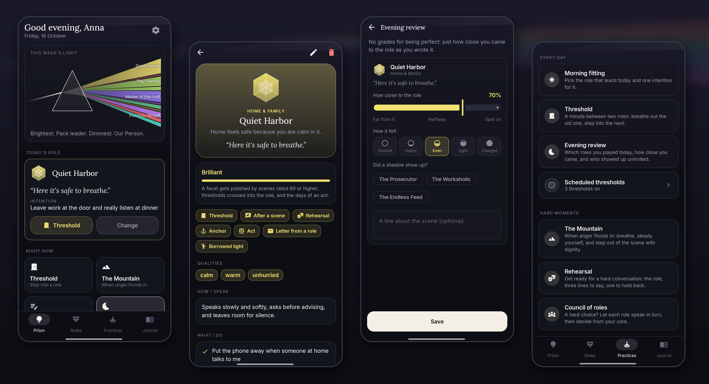
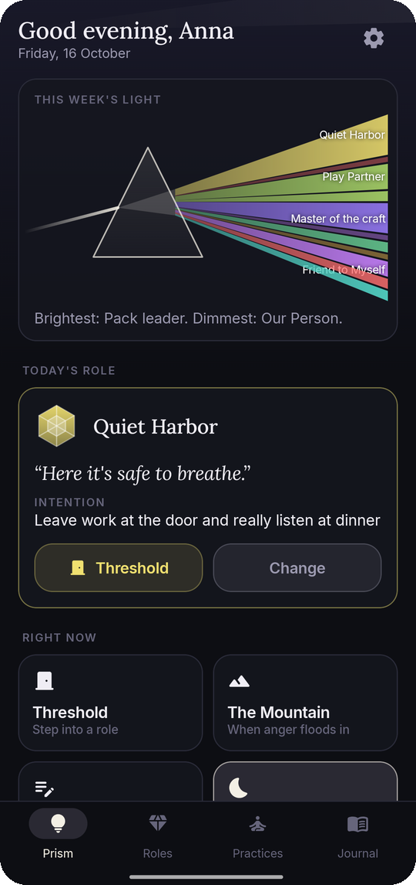
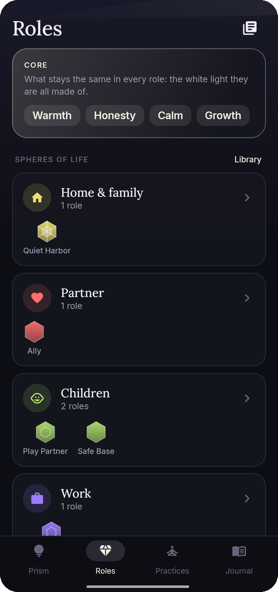
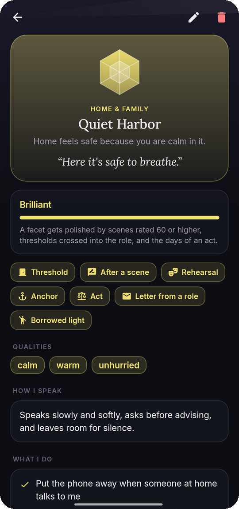
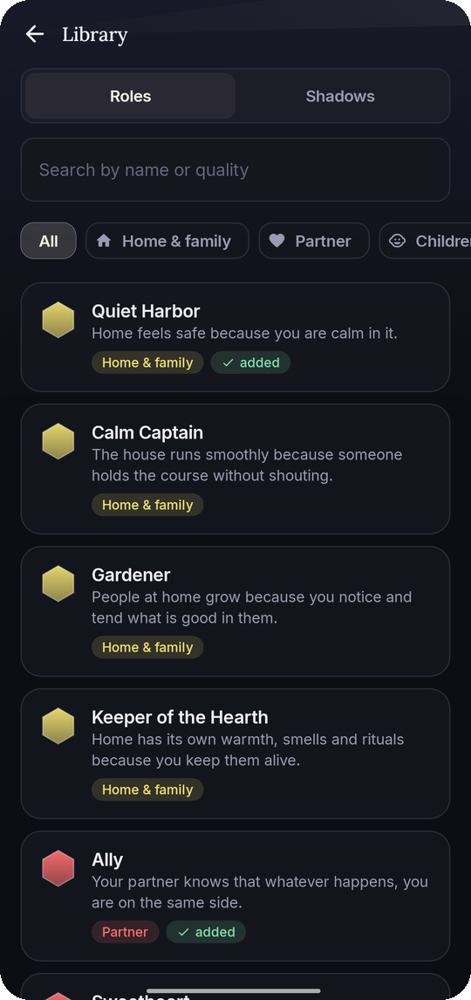
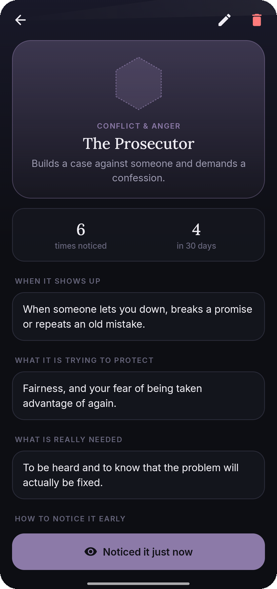
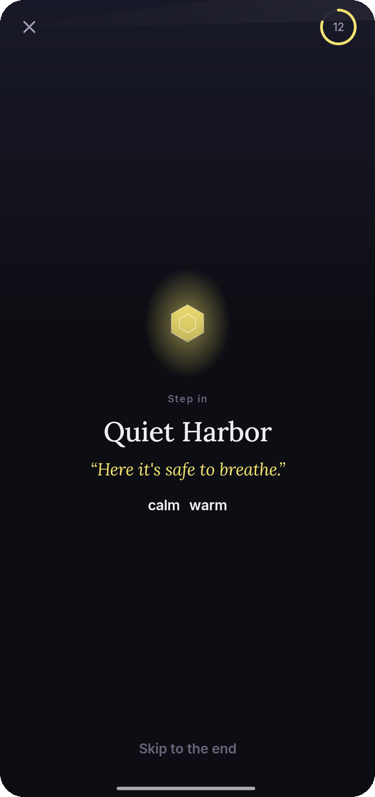
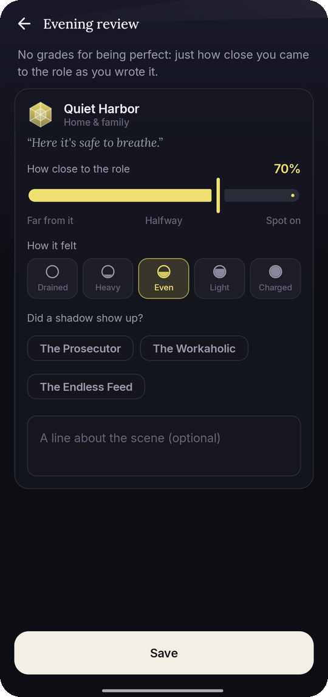
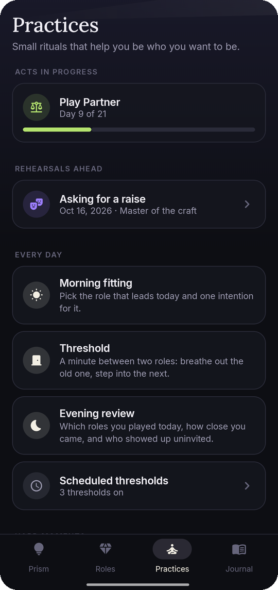
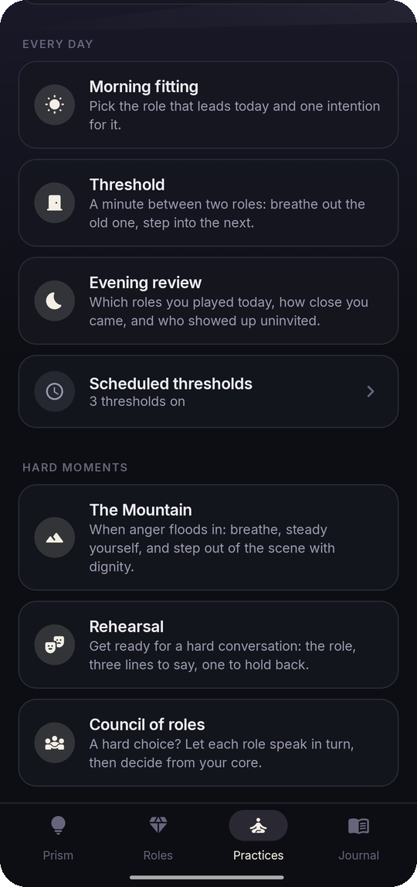

<div align="center">


# Prism

### One light, many colours

*You are one person at home, another at work, another with your parents, and someone else entirely when you're angry. Prism helps you decide who you want to be in each part of your life. Write your roles, or borrow from a library of 71 good ones. Name the shadows you slip into, and practise the switch with short rituals. Your values are the white light. Your roles are the colours it splits into. No ads, no account, works offline.*

[](https://github.com/bigdevwhale/prism/actions/workflows/android.yml)
[](https://github.com/bigdevwhale/prism/releases/latest)


[](LICENSE)

**English** · [Русский](README.ru.md) · [Website](https://bigdevwhale.github.io/stillcraft/apps/prism/) · [Changelog](CHANGELOG.md)



</div>

---

## The idea

Nobody is the same person everywhere, and that's fine. A good parent, a good colleague and a good friend need different things from you. Trouble starts when the roles happen to you instead of being chosen. Then you bring the office home, turn into a sulking teenager at your parents' table, or let anger write your messages for you.

Prism makes the roles visible. First you name your **core**: three to five values that stay the same everywhere. Then, for each sphere of life, you describe who you want to be there: how that person speaks, what they always do and never do, how they stand and breathe, and a short motto that switches them on. Every day you choose which role leads, cross into it with a short ritual, and look back in the evening at how close you came.

## Spheres and roles

| | What | How it works |
|---|---|---|
| ⚪ | **Core** | Your values, the white light every role is made of. They show up in the council of roles when a choice is hard. |
| 🌈 | **22 spheres** | Home and family, partner, children, parents, relatives, friends, work, leading, clients and deals, learning, creating, body and sport, money, alone with yourself, meaning, community, new people, conflict and anger, hard times, rest and play, online, caring for someone. You can also **add your own** with a name, an icon and a colour. |
| 💎 | **Library of 71 roles** | At least three good roles for every sphere: Quiet Harbor, Safe Base, Grateful Grown-up, Master of the craft, Calm Mountain, Friend to Myself… Each has qualities, a voice, three things it does, two it never does, a posture, a motto, a daily practice and seven tasks for a three-week act. Add one in a tap and rewrite it in your own words. |
| 🌑 | **18 shadows** | The Prosecutor, the Sulking Teen, the Workaholic, the Endless Feed, the Martyr, the Iceberg… Shadows are drawn as parts trying to help clumsily, not as villains. For each one: what sets it off, what it's protecting, what's really needed, how to spot it early, and which role answers it. |
| ✨ | **Cuts** | A role grows from Sketch to Facet, Polished and Brilliant. Points come from scenes rated 60 or higher, thresholds crossed into the role, and days of an act. |

## Practices

| | Practice | What it does |
|---|---|---|
| ☀️ | **Morning fitting** | Pick the role that leads today and one intention for it. |
| 🚪 | **Threshold** | A minute between two roles: breathe out the last scene, pause, then step in. The role's colour, name, motto and posture fade in. You can schedule thresholds too, like "coming home, weekdays at 18:30". |
| 🌙 | **Evening review** | Which roles you played today, how close you came (0–100), how it felt, and which shadow showed up. |
| 🏔️ | **The Mountain** | For when anger floods in: stop, three rounds of 4-7-8 breathing, grounding, a ready line to step out with dignity, and the role to come back as. |
| 🎭 | **Rehearsal** | Get ready for a hard conversation: the role, three lines to say, one to hold back, an exit line. A guided walk-through, then how it went. |
| 🪑 | **Council of roles** | A hard choice? Each role speaks in turn, then the core decides. |
| ✉️ | **Written practices** | A letter from a role, through their eyes, the speech at your eightieth birthday, meeting a shadow, borrowed light from someone who plays a role well. |
| ⚓ | **Anchor** | Tie a role to a gesture, a word and a memory, and charge it. |
| 🗓️ | **Act** | 7, 14 or 21 days with one role and a small task every day. |

## Every day

- **The prism.** White light enters from the left and leaves as one coloured ray per role. A ray's width shows how often you played the role this week, and its brightness shows how close you came.
- **The journal.** The prism over 7, 30 or 90 days, a radar of how your scenes spread across the spheres, what charges you and what drains you, how often each shadow showed up, every role's cut and the full history.
- **Today's role** on the home-screen widget, reminders for the morning choice, the evening review and scheduled thresholds.

<table>
  <tr>
    <td></td>
    <td></td>
    <td></td>
    <td></td>
    <td></td>
  </tr>
  <tr>
    <td></td>
    <td></td>
    <td></td>
    <td></td>
    <td></td>
  </tr>
</table>

## English & Русский

Every screen and the whole library of roles and shadows are written natively in both languages, not machine-translated. In Russian the app asks how to address you and uses the right grammatical gender throughout. Switch in **Settings → Language**; on Android 13+ the app also appears in the system's per-app language settings.

## Download

Get the APK from **[Releases](https://github.com/bigdevwhale/prism/releases/latest)**, or the debug APK attached to any [CI run](https://github.com/bigdevwhale/prism/actions/workflows/android.yml). Prism needs Android 8.0 (API 26) or newer.

> [!TIP]
> On Xiaomi (MIUI / HyperOS), Huawei and some other phones, allow **Autostart** and remove battery limits so the morning choice, the evening review and scheduled thresholds arrive on time.

## Privacy

Prism has no accounts, no servers, no analytics, no ads and no internet permission. Roles, scenes, letters and councils live on the phone. **Settings → Backup** exports everything to one JSON file you keep.

## Under the hood

- **Kotlin + Jetpack Compose**, Material 3 with a custom graphite palette (and a paper one), the Lora and Inter typefaces. The prism, the facets, the radar and the threshold beam are drawn on a `Canvas`.
- **Room** stores the core, spheres, roles and shadows (one table, since a shadow is a role with a flag), scenes, day plans, rehearsals, scheduled thresholds, acts and written notes. **DataStore** holds the settings.
- The library lives in `content/` as plain Kotlin, one file per language with identical keys. A unit test checks that both languages match and every role is complete. Russian text carries `{m|f}` gender marks, which are resolved when a role is added.
- `domain/World` holds the shared rules: role stats, cuts, the rays of the prism, the balance of spheres, energy, shadow counts and acts.

```
app/src/main/java/app/prism/
├── content/     the library: 22 spheres, 71 roles, 18 shadows, EN and RU
├── data/        Room database, settings, JSON backup, demo seed
├── domain/      stats, cuts, rays, balance, acts, gender marks
├── notify/      morning choice, evening review, scheduled thresholds
├── widget/      today's role on the home screen
└── ui/          prism, roles, practices, journal, onboarding, settings
```

Build it with `./gradlew assembleDebug`. `./gradlew installDebug -Pdemo` installs `app.prism.demo` with a made-up month of roles, scenes and practices, the one used for these screenshots.

## License

[MIT](LICENSE). Part of [Stillcraft](https://bigdevwhale.github.io/stillcraft/), small tools for a quieter mind.
