<div align="center">

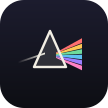

# Prism

### Один свет, много цветов

*Дома ты один, на работе другой, с родителями третий, а когда злишься, вообще кто-то незнакомый. Prism помогает решить, кем ты хочешь быть в каждой части своей жизни. Опиши свои роли или возьми из библиотеки 71 хорошую роль. Назови тени, в которые соскальзываешь, и тренируй переход короткими ритуалами. Твои ценности — белый свет, а роли — цвета, на которые он распадается. Без рекламы и аккаунта, работает офлайн.*

[](https://github.com/bigdevwhale/prism/actions/workflows/android.yml)
[](https://github.com/bigdevwhale/prism/releases/latest)


[](LICENSE)

[English](README.md) · **Русский** · [Сайт](https://bigdevwhale.github.io/stillcraft/apps/prism/) · [История изменений](CHANGELOG.md)

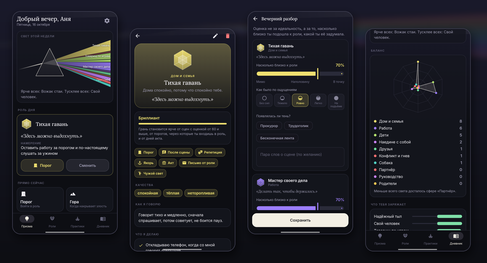

</div>

---

## Идея

Никто не бывает одинаковым везде, и это нормально. Хорошему родителю, коллеге и другу нужно от тебя разное. Беда начинается, когда роли случаются сами, а не выбираются. Тогда ты приносишь работу домой, за родительским столом превращаешься в обиженного подростка, а сообщения за тебя пишет злость.

Prism делает роли видимыми. Сначала ты называешь своё **ядро** — три-пять ценностей, которые одинаковы везде. Потом для каждой сферы жизни описываешь, кем хочешь там быть: как этот человек говорит, что всегда делает и чего не делает никогда, как стоит и дышит, и короткий девиз, который его включает. Каждый день ты выбираешь, какая роль ведёт, входишь в неё через короткий ритуал, а вечером смотришь, насколько получилось.

## Сферы и роли

| | Что | Как устроено |
|---|---|---|
| ⚪ | **Ядро** | Твои ценности — белый свет, из которого сделана каждая роль. Они же принимают решение на совете ролей, когда выбор трудный. |
| 🌈 | **22 сферы** | Дом и семья, партнёр, дети, родители, родня, друзья, работа, руководство, клиенты и переговоры, учёба, творчество, тело и спорт, деньги, наедине с собой, смысл, общество, новые люди, конфликт и гнев, трудные времена, отдых и игра, онлайн, забота о близком. Можно **добавить свою** — с названием, иконкой и цветом. |
| 💎 | **Библиотека из 71 роли** | Минимум три хорошие роли для каждой сферы: Тихая гавань, Надёжный тыл, Благодарный взрослый, Мастер своего дела, Спокойная гора, Друг себе… У каждой есть качества, манера речи, три вещи, которые она делает, и две, которых не делает никогда, осанка, девиз, ежедневная практика и семь заданий для трёхнедельного акта. Добавляется одним нажатием, а дальше её можно переписать своими словами. |
| 🌑 | **18 теней** | Прокурор, Обиженный подросток, Трудоголик, Бесконечная лента, Мученик, Айсберг… Тень здесь не злодей, а часть тебя, которая неуклюже пытается помочь. Для каждой: что её запускает, что она защищает, что на самом деле нужно, как заметить её заранее и какая роль ей отвечает. |
| ✨ | **Огранка** | Роль растёт от наброска к грани, огранке и бриллианту. Очки дают сцены с оценкой от 60, пороги, через которые ты входишь в роль, и дни акта. |

## Практики

| | Практика | Что даёт |
|---|---|---|
| ☀️ | **Утренняя примерка** | Выбери роль, которая ведёт сегодняшний день, и одно намерение для неё. |
| 🚪 | **Порог** | Минута между ролями: выдохнуть прошлую сцену, замереть и войти в новую. Проявляются цвет роли, имя, девиз и осанка. Пороги можно ставить по расписанию, например «Домой, по будням в 18:30». |
| 🌙 | **Вечерний разбор** | Какие роли были сегодня, насколько близко к задуманному (0–100), как было по ощущениям и какая тень пришла без приглашения. |
| 🏔️ | **Гора** | Когда накрывает злость: стоп, три круга дыхания 4-7-8, опора, готовая фраза, чтобы достойно выйти из сцены, и роль, в которой вернуться. |
| 🎭 | **Репетиция** | Подготовка к трудному разговору: роль, три фразы, которые скажешь, одна, которую не скажешь, и фраза для выхода. Потом проживание сцены по шагам, а после разговора — как всё прошло. |
| 🪑 | **Совет ролей** | Трудный выбор? Каждая роль высказывается по очереди, а решение принимает ядро. |
| ✉️ | **Письменные практики** | Письмо от роли, взгляд со стороны, речь на восьмидесятилетие, встреча с тенью и «чужой свет» — у того, кто хорошо играет эту роль. |
| ⚓ | **Якорь** | Привяжи роль к жесту, слову и воспоминанию и «заряди» его. |
| 🗓️ | **Акт** | 7, 14 или 21 день с одной ролью и маленьким заданием на каждый день. |

## Каждый день

- **Призма.** Белый луч входит слева и выходит цветными лучами — по одному на роль. Ширина луча показывает, как часто эта роль звучала на неделе, а яркость — насколько близко к задуманному.
- **Дневник.** Призма за 7, 30 или 90 дней, радар того, как сцены распределились по сферам, что заряжает и что истощает, как часто приходила каждая тень, огранка всех ролей и вся история.
- **Роль дня** в виджете на главном экране, напоминания об утреннем выборе, вечернем разборе и порогах по расписанию.

<table>
  <tr>
    <td>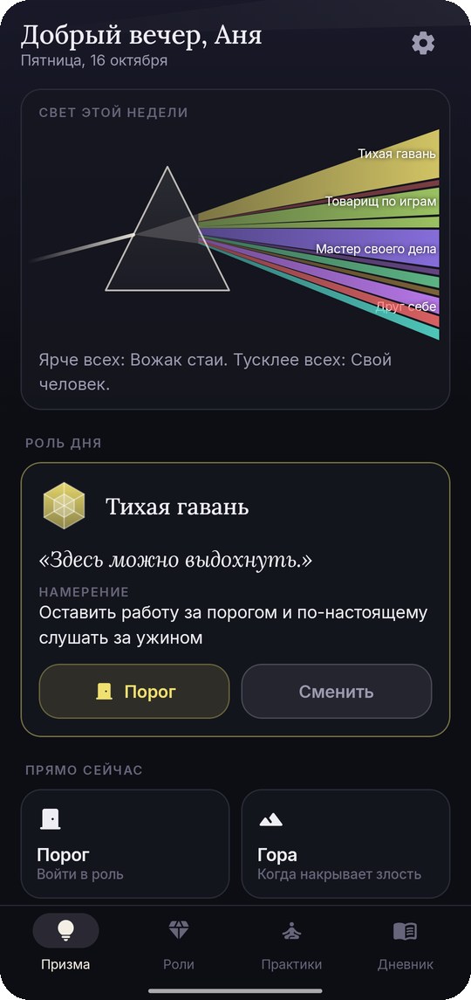</td>
    <td>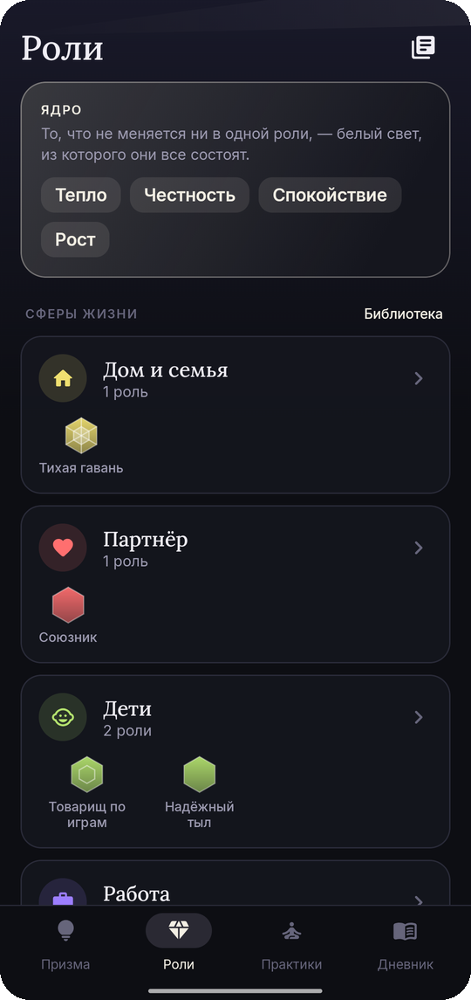</td>
    <td>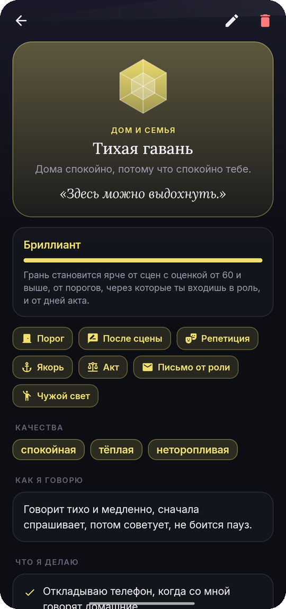</td>
    <td>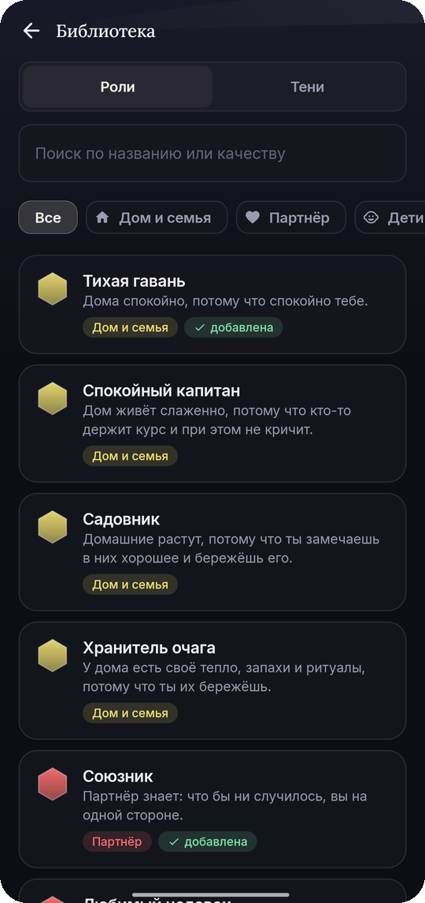</td>
    <td>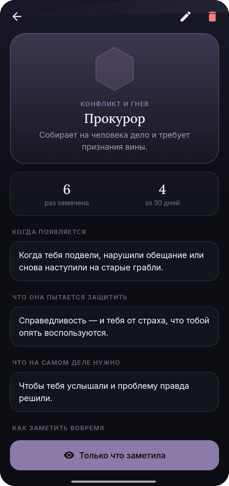</td>
  </tr>
  <tr>
    <td>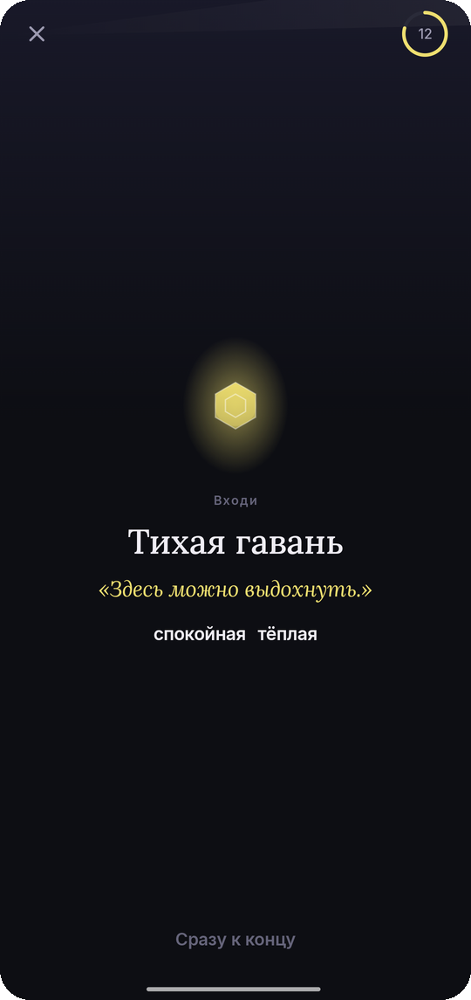</td>
    <td>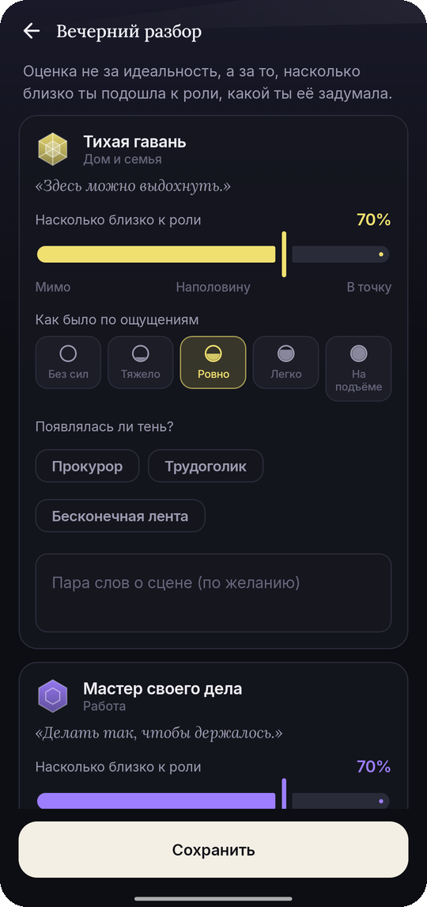</td>
    <td>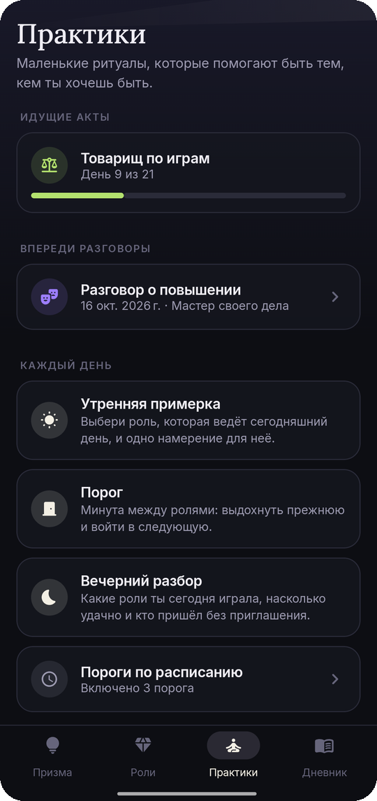</td>
    <td>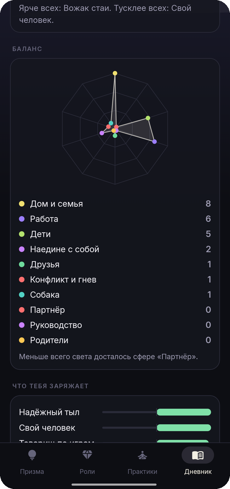</td>
    <td></td>
  </tr>
</table>

## English и Русский

Каждый экран и вся библиотека ролей и теней написаны на обоих языках, без машинного перевода. По-русски приложение спрашивает, как к тебе обращаться, и везде использует правильный род. Язык меняется в **Настройки → Язык**; на Android 13+ приложение также есть в системных настройках языка для приложений.

## Скачать

APK лежит в **[Releases](https://github.com/bigdevwhale/prism/releases/latest)**, отладочный APK есть в каждом [прогоне CI](https://github.com/bigdevwhale/prism/actions/workflows/android.yml). Нужен Android 8.0 (API 26) или новее.

> [!TIP]
> На Xiaomi (MIUI / HyperOS), Huawei и некоторых других телефонах разреши **автозапуск** и сними ограничения батареи, чтобы утренний выбор роли, вечерний разбор и пороги по расписанию приходили вовремя.

## Приватность

У Prism нет аккаунтов, серверов, аналитики, рекламы и доступа в интернет. Роли, сцены, письма и советы хранятся в телефоне. **Настройки → Резервная копия** сохраняет всё в один JSON-файл, который остаётся у тебя.

## Как устроено

- **Kotlin + Jetpack Compose**, Material 3 с собственной графитовой палитрой (и бумажной), шрифты Lora и Inter. Призма, грани, радар и луч порога рисуются на `Canvas`.
- **Room** хранит ядро, сферы, роли и тени (в одной таблице: тень — это роль с флагом), сцены, планы дня, репетиции, пороги по расписанию, акты и письменные заметки. **DataStore** хранит настройки.
- Библиотека лежит в `content/` обычным Kotlin-кодом, по файлу на язык с одинаковыми ключами. Юнит-тест проверяет, что языки совпадают и у каждой роли заполнены все поля. В русском тексте есть метки рода `{м|ж}`, они раскрываются, когда роль добавляется.
- В `domain/World` собраны общие правила: статистика ролей, огранка, лучи призмы, баланс сфер, энергия, частота теней и акты.

```
app/src/main/java/app/prism/
├── content/     библиотека: 22 сферы, 71 роль, 18 теней, EN и RU
├── data/        база Room, настройки, JSON-копия, демо-данные
├── domain/      статистика, огранка, лучи, баланс, акты, метки рода
├── notify/      утренний выбор, вечерний разбор, пороги по расписанию
├── widget/      роль дня на главном экране
└── ui/          призма, роли, практики, дневник, знакомство, настройки
```

Сборка: `./gradlew assembleDebug`. `./gradlew installDebug -Pdemo` ставит `app.prism.demo` с выдуманным месяцем ролей, сцен и практик, по нему сделаны эти скриншоты.

## Лицензия

[MIT](LICENSE). Часть [Stillcraft](https://bigdevwhale.github.io/stillcraft/) — небольших инструментов для спокойного ума.
